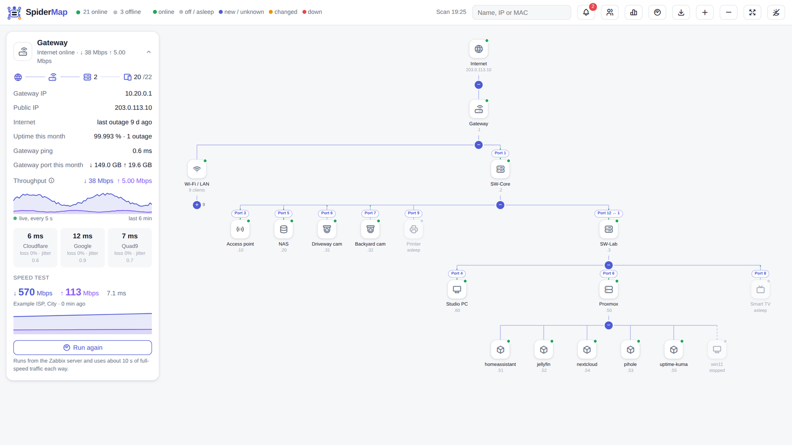
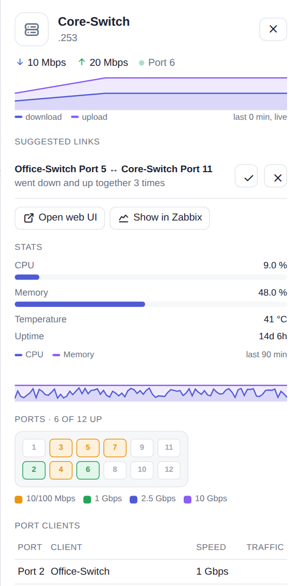
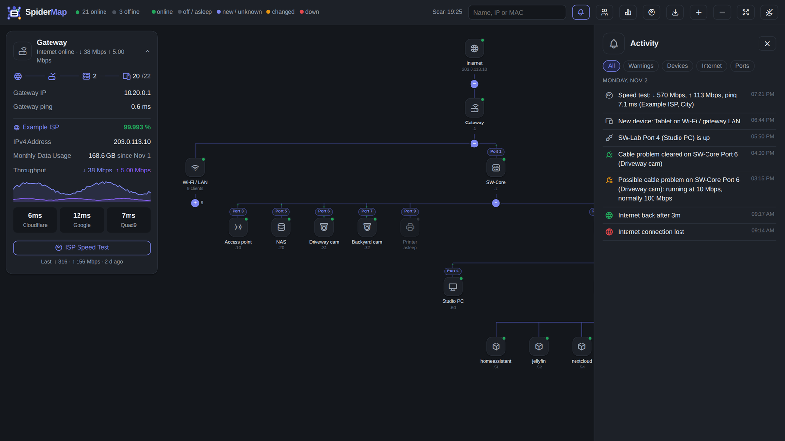

<p align="center">
  <picture>
    <source media="(prefers-color-scheme: dark)" srcset="assets/spidermap-dark.png">
    
  </picture>
</p>

<p align="center">
  <b>A live, beautiful map of your network, built automatically from your switches and Zabbix.</b><br>
  Every device, every port, every change.
</p>

<p align="center">
  
</p>

## What it does

**🕸️ Maps your network by itself**
Reads LLDP and the switches' MAC tables, and draws the real topology: Internet → gateway → switches → devices →
Proxmox guests. Every link is labelled with its port, and every device has an icon picked from its type.

**⚡ Live**
Port traffic every 5 seconds with animated links, ports coloured by speed (100 Mbps, 1 / 2.5 / 10 Gbps),
CPU, memory and disk for switches, servers and VMs, with graphs.

**🌐 Internet health**
Throughput, latency, packet loss and jitter to the gateway and the internet, uptime and outages this month,
public IP changes, and a speed test on demand or every night.

**🔔 Nothing touches the web unnoticed**
An activity feed and Zabbix alerts for:
- new and **unknown devices**, especially ones plugged into a free switch port
- devices that **move** to another port, **IP changes** and **IP conflicts**
- **possible cable problems**: port errors, flapping links, a port dropping from 1 Gbps to 100 Mbps
- **unusual traffic**, like a camera suddenly uploading at 3 am
- **internet outages**, packet loss, ports going up and down, important devices going offline

**👥 And more**
Who's online (presence timeline), top talkers, device list export (CSV), edit names, icons and web UI addresses
straight from the map, light and dark theme.

<p align="center">
  
  
</p>

SpiderMap only **reads** from your network. It never changes your switch configuration.

## Requirements

- **Zabbix 7.0 or newer.** SpiderMap runs on the Zabbix server (or its LXC container), Debian or Ubuntu.
- **Switches in Zabbix with an SNMP interface** and a template that discovers interfaces.
  Port names and traffic are tested with interface tables of Huawei VRP, MikroTik RouterOS, TP-Link Omada and
  Cisco-style switches; other brands using the standard IF-MIB, BRIDGE-MIB and LLDP-MIB should work.
- **LLDP enabled** on the switches (and `lldpd` on Linux and Proxmox hosts so they are recognised).
- A Zabbix **API token** for an admin user: *Users → API tokens → Create API token*.

## Install

```bash
apt install -y git
git clone https://github.com/<you>/spidermap.git /opt/spidermap
cd /opt/spidermap
bash install.sh
```

The installer sets up the packages it needs, asks for your Zabbix API address and token, creates the system user
`spidermap` and starts the **`spidermap` service**, which runs the scans (no cron jobs) and the first scan right away.
Configuration goes to `/etc/spidermap`, data to `/var/lib/spidermap`; `zabbix.env` and `devices.json` in
`/opt/spidermap` are links there. Upgrading from the earlier
*zabbix-netmap* version? The installer finds it and moves your devices, settings and history over.

**One manual step in Zabbix**, for the dashboard widget:
*Administration → General → Other → Security → Iframe sandboxing exceptions*

```
allow-scripts allow-same-origin allow-popups allow-downloads
```

Then open **Dashboards → SpiderMap**, or the page directly at `http://<zabbix>/zabbix/spidermap.php`
(Zabbix Super admins by default, see [Security](#security)).

## Settings

Zabbix Super admins (by default) find a **Settings** button (the gear) on the map. The dialog has these tabs:

| Tab | What you set |
|---|---|
| General | Map name, map refresh, offline devices, IP labels; backup (export, import, restore an earlier version) |
| Scans | Automatic scan, ICMP discovery, SNMP collection, intervals, ICMP payload, timeout, parallel checks, allowed networks, addresses never to scan; **Scan now / Cancel / Pause** with the scan's progress |
| SNMP | GETBULK max-repetitions, retries, timeout (the credentials come from each switch's interface in Zabbix) |
| Topology | Link sources: LLDP, MAC tables, ARP tables, VLANs |
| Measurements | Link thickness by traffic, units, load warning / critical, status refresh, history, daily speed test |
| Security | Off-peak scan window, packet limit, address limit, who may open, edit, test and change settings |
| Logging | Log level and retention, recent events |
| Device types | 11 categories (firewalls, ONT/modems, UPS/PDU, cameras/NVR, IP phones/PBX, printers, NAS, hypervisors, industrial/IoT, powerline/media converters, out-of-band management), how each is recognised, on/off |
| Wireless & WAN | UniFi controller (read-only user): access points and their wireless clients; more in 0.7.3 |

Every change is checked in the browser and on the server, recorded in the audit log, and the previous version is
kept, so a mistake is one click away from being undone.

**Throughput is the router's WAN.** Devices on the router's own Wi-Fi never pass a switch, so SpiderMap reads the
router itself: over **SNMP** when the gateway is a Zabbix host with an SNMP interface (exact 64-bit counters; the WAN
interface is found from the default route, or set in Settings), otherwise over **UPnP** (many home routers; some stop
counting after a few GB, which SpiderMap recognises). When neither works, the card says "WAN unavailable" and why,
instead of showing other numbers.

**Moving around the map.** The controls at the bottom right zoom, fit, turn the tree **vertical or horizontal**,
**expand or collapse everything** and go **full screen**. The mouse wheel zooms (or scrolls, if you prefer), Shift +
wheel and two-finger scrolling move the map, Ctrl + wheel or a pinch zooms; the arrow keys move, + / − / 0 zoom
and fit.

**Collector health** (the heart icon, for everyone who may open the map) shows the service, the last scans, the
Zabbix API, every switch (answering or not, and its error), the age of the data and the free disk space.

## Your devices: `devices.json`

Created on first install and **never committed to git**. `devices.example.json` shows every option.
Devices can also be changed from the map with the **Edit** button, and most settings from the **Settings** panel.

| Device option | What it does |
|---|---|
| `name` | Display name |
| `type` | Icon: router, switch, unifi, camera, tv, laptop, desktop, phone, printer, appliance, iot, nas, server, vm, lxc |
| `important` | Red on the map and a Zabbix alert when it goes down |
| `url` | Web UI address; `{ip}` is replaced by the current IP, e.g. `http://{ip}:8080` |
| `pin` | Always draw it on this port, e.g. `"SW-Office:3"` (handy for devices that are often off) |

| Setting | What it does |
|---|---|
| `speedtest_daily` | Run a speed test every day at this time, e.g. `"03:30"` (empty = only on demand) |
| `scan_subnets` | Subnets to scan (default: the /24 of each switch) |
| `flag_hours` | How long "new" and "moved" stay highlighted |
| `forget_after_days` | Forget unknown devices not seen for this long |
| `permissions` | Who may do what, as the lowest Zabbix user type (1 = user, 2 = admin, 3 = Super admin): `{"view": 3, "edit": 2, "speedtest": 2}`. Nobody may do more than view; edits never below admin. Run `bash install.sh --update` after a change |
| `port_media` | Mark ports as SFP / SFP+ when SpiderMap cannot tell, per switch: `{"SW-Core": {"17": "SFP+", "18": "SFP+"}}` (`"copper"` removes a mark) |
| `core_switch`, `manual_links`, `aliases` | Only for the classic Zabbix map (`spidermap_zabbix.py`) |

### Optional: Proxmox guest names

Gives every VM and container its real name and running/stopped state. In Proxmox, add the user `spidermap@pve`
with the role **PVEAuditor** on `/`, create an API token `spidermap` for it with *Privilege Separation* unticked,
and add `PVE_URL`, `PVE_TOKEN_ID` and `PVE_TOKEN_SECRET` to `zabbix.env` (see `zabbix.env.example`).

**Check Proxmox's certificate** by adding its fingerprint to `zabbix.env` too; this works with Proxmox's own
self-signed certificate. You find it in Proxmox under *your node → System → Certificates → pve-ssl.pem → View
Certificate*, or on the Proxmox shell:

```bash
openssl x509 -in /etc/pve/local/pve-ssl.pem -noout -fingerprint -sha256     # pveproxy-ssl.pem if you uploaded your own
```

```bash
export PVE_FINGERPRINT="69:E7:68:40:...:E2:0F"
```

Alternatives: `PVE_CA=/path/to/pve-root-ca.pem`, or `PVE_VERIFY=1` for a certificate your system already trusts
(e.g. Let's Encrypt). Without any of these SpiderMap still connects, but writes a warning to its log.

## Update

```bash
cd /opt/spidermap && git pull && bash install.sh --update
```

Open pages reload themselves with the new version.

## Network load

Very light: one small SNMP request per switch every 5 s (about 1–2 KB), a ping sweep of the subnet every
5 minutes, a few short pings to the gateway and 3 public DNS servers every 15 s, and one ping per important device
per minute. A speed test uses about 10 seconds of full-speed traffic each way, so it only runs when you ask for it
or once a day if you set `speedtest_daily`.

## Security

SpiderMap has a single entry point in the Zabbix web folder: **`spidermap.php`**. It checks your Zabbix login
through the public Zabbix API before it shows anything, so it keeps working across Zabbix upgrades.

- **Page and data need a Zabbix login.** By default only **Zabbix Super admins** can open SpiderMap, because it shows
  the whole network. Who may look, edit devices and start speed tests is set separately with `"permissions"` in
  `devices.json` (see *Your settings*). Buttons a user may not use are greyed out with the reason. The Zabbix *guest*
  account is always refused.
- **Nothing about your network is in the web folder.** The page and the map data live in `/var/lib/spidermap/www`,
  readable by root and the web server only. The web folder contains just `spidermap.php`, the icons, and redirects
  from older addresses (`spidermap.html`, `spider-secure.php`).
- **Changes need a Zabbix admin** (or what you set in `permissions`): editing devices and starting speed tests,
  protected against cross-site request forgery (a special request header and an Origin check). The web server can
  write to one folder only, `/var/lib/spidermap/inbox`.
- **Audit log:** every change from the map and every speed test is recorded with the Zabbix user and the time, in
  `/var/lib/spidermap/audit.log` (root only, one JSON line each) and in the activity feed (filter *Changes*).
- **SNMP passwords are never on a command line**, where any local user could see them with `ps`: SpiderMap gives them
  to net-snmp in a private file per switch, in `/var/lib/spidermap/snmp` (folders 700, files 600).
- **Session checks** are reused for at most 10 seconds and never extend an expired Zabbix session.
- **Browser hardening**: no caching, no framing by other sites (`X-Frame-Options`, `frame-ancestors`), and a
  Content-Security-Policy that only allows SpiderMap's own resources.
- Your Zabbix API token stays in `/etc/spidermap/zabbix.env` (root and the service, 640) and never reaches the browser.
- **SpiderMap runs as its own user** `spidermap`, not root, with only the permission `ping` needs and read-only
  access to the rest of the system (the installer checks that this works, otherwise it stays on root and tells you).

### A dedicated Zabbix account for SpiderMap

The installer can use any API token, but a separate account limits what SpiderMap could ever do in Zabbix:

1. **User role** *SpiderMap* (*Users → User roles*): user type **Admin**, *API access* on, and *API methods* set to
   **Allow list**: `host.get`, `item.get`, `item.create`, `trigger.get`, `trigger.create`, `history.push`,
   `usermacro.get`, `image.get`, `dashboard.get`, `dashboard.create`, `dashboard.update`, `dashboard.delete`
   (plus `map.get`, `map.create`, `map.delete` only if you use the classic Zabbix map, `spidermap_zabbix.py`).
2. **User group** *SpiderMap*: *Frontend access* **Disabled**; **Read** on the host groups of your switches and
   servers; **Read-write** on the host group of the *Zabbix server* host, where SpiderMap creates its items and
   triggers.
3. **User** *spidermap* in that group with that role; then *Users → API tokens → Create API token* for it, and put
   the token in `zabbix.env`.

SNMP credentials stored as *Secret text* macros are never returned by the Zabbix API, to any account, so SpiderMap
cannot use them: keep the SNMP credentials as text macros or in the host's SNMP interface.

**Optional extra layer:** a web server rule that blocks any stray `spidermap*.json` in the web folder. Do **not**
block `.php` or `.html` files: `spidermap.php` must stay reachable. The installer warns you if a rule blocks it.

```apache
<FilesMatch "^spidermap.*\.json$">
  Require all denied
</FilesMatch>
```

**HTTPS:** SpiderMap protects *who* can see the map, not the connection itself. Without HTTPS the Zabbix login cookie
travels unencrypted on your network. Enable HTTPS on the Zabbix frontend, even with a self-signed certificate.

**Behind a reverse proxy:** keep forwarding the original host name (nginx: `proxy_set_header Host $host;`),
otherwise edits are refused as cross-site requests. Better still, don't publish Zabbix to the internet and reach it
through a VPN. If you must publish it: HTTPS only, an IP allowlist or an extra login at the proxy, and multi-factor
authentication for Zabbix users (*Users → Authentication → MFA settings*, Zabbix 7.0+).

## Troubleshooting

```bash
systemctl status spidermap                         # the service (scans, live traffic, speed tests)
journalctl -u spidermap -n 30                      # its log
tail -n 30 /var/lib/spidermap/spidermap.log        # output of the scans
cd /opt/spidermap && python3 spidermap.py          # run a scan by hand (as the spidermap user)
cd /opt/spidermap && python3 spidermap.py --check-ports   # how every switch port is seen
tail -n 5 /var/lib/spidermap/audit.log             # recent changes from the map
```

## Files

| File | Purpose |
|---|---|
| `spidermap.py` | The service and its scheduler, scans, live refresh, settings, Zabbix integration |
| `spidermap.html` | The map page (installed in the protected folder, served by `spidermap.php`) |
| `spidermap_ports.py` | Switch port scanner (also usable alone: port report and HTML table) |
| `spidermap_zabbix.py` | Zabbix API and SNMP helpers, plus the classic Zabbix map and dashboard |
| `install.sh` | Installer and updater |
| `tests/` | Automated tests |
| `docs/` | Architecture and release documentation |
| `assets/` | Logo, icons and screenshots |

## Uninstall

```bash
cd /opt/spidermap && bash install.sh --uninstall
```

It first shows everything it will remove and asks; then it writes a backup of your settings, devices and history
to `/root/spidermap-backup-<time>.tar.gz` and removes the service, the `spidermap` user, `/etc/spidermap`,
`/var/lib/spidermap`, SpiderMap's own files in the Zabbix web folder, and in Zabbix only SpiderMap's `autotopo.*`
items (with their triggers), its dashboards and map. Finally remove the code: `rm -rf /opt/spidermap`.

| Option | Effect |
|---|---|
| `--keep-data` | Keep `/etc/spidermap`, `/var/lib/spidermap` and the `spidermap` user, to install again later |
| `--keep-zabbix` | Leave SpiderMap's items, triggers, dashboards and map in Zabbix |
| `--yes` | Do not ask (for scripts) |

Not touched: the system packages, the API token you created in Zabbix and the iframe setting you changed there.
By hand, without the script: `systemctl disable --now spidermap`, remove `/etc/systemd/system/spidermap.service`,
`/etc/spidermap`, `/var/lib/spidermap`, `spidermap.php` and `spidermap-assets/` in the Zabbix web folder, the
user `spidermap`, and in Zabbix the *SpiderMap* dashboard and the items whose key starts with `autotopo.`.

## Documentation

| Document | For |
|---|---|
| [CHANGELOG.md](CHANGELOG.md) | What changed in every version, and upgrade notes |
| [SECURITY.md](SECURITY.md) | Supported versions and how to report a vulnerability |
| [docs/ARCHITECTURE.md](docs/ARCHITECTURE.md) | How SpiderMap works: jobs, files, data flow, Zabbix integration, extending it |
| [docs/RELEASING.md](docs/RELEASING.md) | Checklist for publishing a new version |
| [tests/test_gateway.py](tests/test_gateway.py) | Security tests for `spidermap.php` (`python3 tests/test_gateway.py`, needs `php-cli`) |
| [tests/test_core.py](tests/test_core.py) | Tests for scheduling, edits and job locking (`python3 tests/test_core.py`) |
| [tests/test_ports.py](tests/test_ports.py) | Tests for port names and traffic counters with real switch tables (`python3 tests/test_ports.py`) |

## License

SpiderMap is licensed under the [GNU Affero General Public License v3.0](LICENSE).
